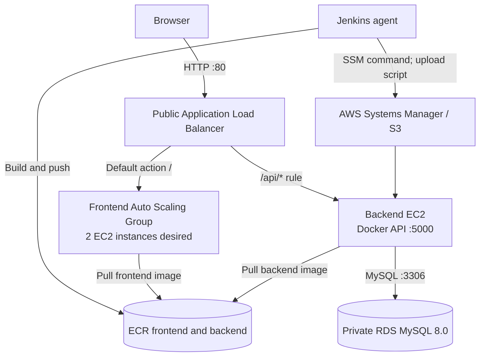

# AWS Terraform Infrastructure and DevOps Demo

This repository contains a small full-stack application and the infrastructure and delivery configuration used to demonstrate deployment on AWS. It brings together a React frontend, an Express/MySQL API, container images, Terraform-managed AWS resources, and a Jenkins pipeline. The intended result is a browser-accessible application whose API persists user records in RDS.

> **Scope and status:** This is a learning/demo project, not a production-ready reference architecture. The Terraform files and Jenkinsfile document the intended design; they are not proof that every resource is currently deployed or that every pipeline stage has been run successfully. A live validation snapshot from 11 October 2026 is summarized below. Re-check AWS before relying on it: no AWS state was queried while preparing this README.

## What the project demonstrates

- Infrastructure as code for a VPC, public and private subnets, routing, security groups, an internet-facing Application Load Balancer, frontend Auto Scaling Group, backend EC2 instance, RDS MySQL, ECR repositories, IAM roles, and VPC endpoints.
- A React single-page app that lists users and submits new users to the API.
- An Express API with health, database-health, list-users, and create-user routes.
- Docker builds for the frontend and backend, plus a local Compose setup with MySQL.
- Jenkins stages for Terraform formatting, initialization, validation and planning; image build and ECR push; an SSM connectivity check; and an opt-in backend deployment using S3 and SSM.
- A backend deployment script that pulls an immutable ECR digest, checks a candidate container before switching traffic, and attempts to restore the previous container if the switch fails.

The words “production” in resource names and the repository name reflect naming in the project. They do not mean the configuration meets production availability, security, backup, or change-management requirements.

## Architecture



### Network and request flow

- Terraform defines VPC `10.0.0.0/16` in `eu-north-1`, with public subnets `10.0.1.0/24` and `10.0.2.0/24`, and private subnets `10.0.11.0/24` and `10.0.12.0/24` in availability zones `eu-north-1a` and `eu-north-1b`.
- The public route table sends internet-bound IPv4 traffic through an internet gateway. The private route table has no default internet route. It is associated with an S3 gateway endpoint and interface endpoints for ECR, SSM, and STS.
- The ALB is internet-facing and listens on HTTP port 80. Its default action forwards to the frontend target group on port 80. A `/api/*` listener rule forwards requests to the backend target group on port 5000.
- The frontend Auto Scaling Group spans the two public subnets, with minimum 1, desired 2, and maximum 2 instances. The launch template installs Docker, pulls the mutable `latest` frontend image from ECR, and runs it on port 80.
- The backend EC2 instance is placed in a private subnet. Its target group health check is `GET /api/health` and expects HTTP 200. The backend security group accepts port 5000 from the ALB security group.
- RDS MySQL is private, encrypted at rest, 20 GiB gp3, `db.t3.micro`, and configured as single-AZ. Port 3306 is allowed only from the backend security group. The database subnet group spans the two private subnets.
- The browser calls relative `/api/...` paths, so the ALB path rule keeps frontend and API traffic on the same origin.

The files define VPC endpoints for S3, ECR API/Docker, SSM, SSM Messages, EC2 Messages, and STS. They do not define a NAT gateway. Private workloads therefore depend on the configured endpoints for the AWS services they need; external internet access from a private instance is not established by these files.

### Important architecture caveats

- There is no HTTPS listener or ACM certificate in the Terraform. Prior inspection of the live ALB showed a single HTTP:80 listener. Browser traffic is therefore unencrypted in transit at the ALB in the observed demo configuration.
- The frontend instances are assigned public subnets and public IP mapping is enabled, although their inbound security group allows HTTP only from the ALB security group. Review whether public subnet placement is necessary for the intended design.
- The backend instance bootstrap in `terraform/backend-ec2.tf` only writes a status marker. It does not install Docker, configure the application, or run the deployment script. The SSM deployment assumes those host prerequisites already exist.
- Terraform sets RDS `deletion_protection = false` and `skip_final_snapshot = true`; accidental destruction can permanently remove database data.
- The application allows all CORS origins. Same-origin ALB routing makes broad CORS unnecessary for the demonstrated browser flow and it should be narrowed before broader use.

## Repository map

| Path | Purpose |
|---|---|
| `frontend/` | Vite + React user interface, Docker build, and static Nginx runtime. |
| `backend/` | Express API, MySQL connection pool, package manifests, and Docker build. |
| `database/init.sql` | Local MySQL database/table creation and demo seed records. |
| `docker-compose.yml` | Local MySQL, backend, and frontend services with a named database volume. |
| `terraform/` | AWS provider/version constraints, S3 backend settings, networking, compute, ALB, RDS, ECR, IAM, security groups, and VPC endpoints. |
| `Jenkinsfile` | CI and deployment pipeline, including the opt-in backend deploy stage. |
| `scripts/deploy-backend.sh` | Remote candidate deployment, health/API checks, traffic switch, and best-effort rollback. |
| `Jenkinsfile.backup`, `scripts/deploy-backend.sh.backup` | Untracked backup files observed in the working tree; their intended lifecycle is unknown. They are not authoritative pipeline/script inputs. |

`terraform/ec2.tf` and `terraform/target-attachment.tf` are empty in the inspected checkout. The backend attachment is defined in `backend-target-attachment.tf`; the frontend is attached through its Auto Scaling Group target-group association.

## Application behavior

### Frontend

The React app renders an “Add User” form and a users table. It reads and writes through `/api/users`. The production Dockerfile uses a Node build stage (`npm ci`, `npm run build`) and copies the generated static assets into Nginx. The Terraform launch template pulls and runs the frontend image on port 80.

### Backend API

The Express service listens on `PORT` (default 5000), uses `mysql2/promise` connection pooling, and loads configuration from environment variables. Implemented routes are:

| Method | Route | Behavior |
|---|---|---|
| `GET` | `/api/health` | Process health response; does not prove database connectivity. |
| `GET` | `/api/db-health` | Executes `SELECT 1` and reports database connectivity. |
| `GET` | `/api/users` | Returns users ordered by ID. |
| `POST` | `/api/users` | Requires `name` and `email`, inserts a user using a parameterized query, and returns the created record. |

`database/init.sql` creates the `devops_app.users` table and two sample rows for local MySQL initialization. It is not shown as an RDS migration mechanism. The live demo later returned a third user inserted through the API and confirmed it in MySQL; this validates the observed end-to-end path at that time, not repeatability from a clean AWS account.

## Local development

Requirements: Docker Engine with the Compose plugin. From the repository root:

```sh
docker compose up --build
```

The Compose file maps the frontend to `http://localhost:5173` and the backend container port 5000 to host port 5001. MySQL is internal to the Compose network and stores data in the `mysql_data` named volume. On first database initialization, `database/init.sql` creates the database and sample rows.

The Compose file currently contains demo credentials (`devopsroot`) directly in the YAML. Treat them as local-only throwaway values; do not reuse them in AWS or a shared environment. Move local credentials to an ignored environment file or secret mechanism before using this beyond a disposable demo.

To stop the services while retaining local database data:

```sh
docker compose down
```

To remove the local Compose database volume as well, which permanently deletes its contents:

```sh
docker compose down --volumes
```

Inspect the target and its data before using the volume-removal option.

## Jenkins CI/CD workflow

The checked-in `Jenkinsfile` uses a Jenkins agent with Windows batch and PowerShell support, Terraform, AWS CLI, Docker, and network access to AWS. It defines a boolean parameter `DEPLOY_BACKEND`, default `false`.

1. **Checkout:** checks out the configured SCM revision.
2. **Terraform format:** runs `terraform fmt -check` in `terraform/`.
3. **Terraform init:** binds Jenkins credential `aws-terraform` to AWS access-key environment variables, sets region `eu-north-1`, and initializes the S3 backend.
4. **Terraform validate:** validates the initialized configuration.
5. **Terraform plan:** binds the same AWS credential and Jenkins secret `rds-password` to `TF_VAR_rds_password`, then runs `terraform plan`.
6. **Build images:** builds `devops-backend:latest` and `devops-frontend:latest`.
7. **Push images:** authenticates to ECR and pushes the backend under both `latest` and the Jenkins build number; the frontend is pushed as `latest`.
8. **SSM access check:** submits a harmless echo command to a hard-coded EC2 instance and polls for a successful invocation.
9. **Optional backend deployment:** only runs if `DEPLOY_BACKEND=true`. It resolves the build-number image tag to an ECR digest, uploads `scripts/deploy-backend.sh` to a versioned S3 key, checks the script checksum on the instance, runs it via SSM, and polls for the final command status.

The deploy script validates the ECR digest format, takes a non-blocking lock, checks the current container/network/port and existing health, starts a candidate on loopback port 15001, checks `/api/health` and `/api/users`, and only then switches the production container. On a failed switch, its exit handler attempts to restore the previous container. A successful deployment keeps the prior container under `devops-backend-rollback` for operator-controlled recovery. This is a single-instance replacement with a brief stop/switch interval, not a zero-downtime rolling deployment.

### Pipeline prerequisites and operational cautions

- Configure Jenkins credentials with IDs `aws-terraform` and `rds-password`. The former is modeled as an access-key/secret-key pair; use a least-privilege identity and rotate credentials. Prefer short-lived role credentials where the Jenkins environment supports them.
- The pipeline hard-codes AWS account ID, region, ECR repository names, S3 deployment bucket, and SSM instance ID. These must be reconciled with the target account/environment before use. In particular, confirm the instance ID still identifies the Terraform-managed backend.
- Terraform backend bucket `aws-terraform-production-infrastructure-tfstate-451782721795` must already exist and be accessible. It is not created by the checked-in Terraform. Protect state with encryption, versioning, access restrictions, and recovery procedures at the bucket level; these controls are not visible in this repository.
- `terraform init` may need AWS credentials to access the remote state. `terraform plan` is read-only with respect to infrastructure but can refresh remote state and call AWS APIs. The pipeline contains no `terraform apply` stage.
- Image publishing and the SSM access check occur before the optional deployment gate. A normal build with `DEPLOY_BACKEND=false` can still push images and run the SSM access check; it is not a purely local validation pipeline.
- The Jenkinsfile pushes mutable `latest` tags. Frontend instances pull `latest` during launch, so instance replacement can change deployed content without an explicit Terraform source revision. The backend deploy stage is stronger: it selects a numbered build and deploys by digest.
- The Terraform provider constraint is AWS provider `~> 6.0`, while Terraform itself is declared as `>= 1.6.0`. The S3 backend uses `use_lockfile = true`; confirm the actual Terraform CLI version supports this backend option and raise the minimum version to match the supported toolchain.
- The Terraform RDS block currently contains `password = "var.rds_password"` (a quoted string) rather than an expression referencing the sensitive variable. As written, the Jenkins-provided `TF_VAR_rds_password` is not used for the RDS password. This is a configuration defect to correct and review before any plan/apply workflow; this README does not change infrastructure code.
- The pipeline's successful `terraform plan` cannot be assumed until the password expression and all prerequisites are corrected/confirmed. No plan, apply, or destroy was run for this README task.

## Terraform workflow

The backend configuration in `terraform/backend.tf` points to an existing S3 bucket and key in `eu-north-1`, with S3 lockfile-based state locking enabled. The AWS provider region is also set to `eu-north-1`; the project uses fixed VPC CIDRs, AZ names, AMI, resource names, and account-specific references.

A cautious review workflow for an authorized operator is:

```sh
cd terraform
terraform fmt -check
terraform init
terraform validate
terraform plan
```

Review the plan and state changes before any apply. These commands are documented for future operators; they were not run as part of this documentation update. Never commit `.tfstate`, plan files, secret variable files, or credentials. `.gitignore` excludes Terraform state, `.terraform/`, and `.tfvars` files, but exclusions do not remove files already tracked or leaked elsewhere.

Before using this configuration outside its demo context, parameterize account-specific values and AMI/AZ choices; validate state-bucket controls and recovery; correct the RDS password expression; assess deletion protection/snapshots; confirm private-subnet dependencies and endpoints; and review IAM and security-group scope. Do not apply changes until a human has reviewed the plan and approved the environment-specific change.

## Verified demo validation snapshot (11 October 2026)

The prior project session recorded these observations in `eu-north-1`:

- ALB `devops-production-alb` was `active`; its listener was HTTP on port 80 with a forward default action.
- The frontend Auto Scaling Group had desired capacity 2 and two instances in `InService`/`Healthy` state.
- The frontend and backend target groups reported healthy targets. Their configured health paths were `/` and `/api/health`, respectively.
- `GET /`, `GET /api/health`, and `GET /api/users` through the ALB returned HTTP 200.
- MySQL RDS `devops-mysql` was reported `available`; the API returned user records, and a newly created row was separately observed in the database.
- The backend container on the EC2 instance was reported running with restart policy `unless-stopped`.
- The backend SSM deployment directory and script were present on the instance. This shows the files were installed; it does not prove that every current Jenkins deploy invocation or rollback path has been exercised.

These are historical checks supplied in the referenced project conversation, not live checks performed for this README. They may no longer describe the deployed environment.

## Troubleshooting record

The following entries preserve concrete issues and outcomes from the project session. Where a root cause or remediation was not fully established, that uncertainty is stated.

| Symptom | Cause or diagnosis | Action and verification |
|---|---|---|
| `mysql --version` returned `command not found` in the developer's Git Bash session. | The local Windows/Git Bash environment did not have the MySQL CLI on `PATH`; this was a client-tool issue, not evidence that RDS was unavailable. | The operator later found `mysql` and `mariadb` binaries on the EC2 host (`/usr/bin/mysql`, `/usr/bin/mariadb`) and continued database checks there. The session subsequently reported MySQL working and showed the `users` table and rows. |
| A direct RDS login returned `ERROR 1045` for user `YOUR_DB_USERNAME`. | The command was run with the literal example placeholder as the username. Network reachability was not the cause indicated by this error. The repository declares `devopsadmin` as the Terraform DB username, but the actual live DB username/password must be confirmed from the deployed configuration. | The session later confirmed database-backed API reads and a successful row in MySQL. Avoid copying placeholder credentials into commands; use the real provisioned username and retrieve the password through the approved secret source. |
| `curl -I http://127.0.0.1:5000` returned HTTP 404 on the backend host. | The API does not define a root `/` route. The health route is `/api/health`; an HTTP response from `/` alone is not a useful backend health test. | The ALB checks and later curl probes used `/api/health`; the route returned HTTP 200. `/api/users` also returned HTTP 200 through the ALB. |
| ACM certificate listing failed with `AccessDeniedException` for `acm:ListCertificates`. | The active IAM identity lacked that action. The command's denial does not establish whether a certificate exists. | The Terraform repository has no ACM resource and the observed ALB listener was HTTP:80 only. HTTPS is therefore not configured by the checked-in infrastructure; the permission issue was not a certificate fix. |
| A backend rollback container showed `Exited (1)` and logs ended with `SIGTERM` during a container replacement. | `SIGTERM` is consistent with Docker stopping the old process during a deployment; by itself it does not prove an application crash. The prior container was observed stopped while the newer backend container was running. | The session compared image IDs and found distinct current/rollback images; it also confirmed an older image existed locally. The currently running API and database route were verified through the ALB. A full automated failure-and-rollback drill was not evidenced, so treat recovery as best-effort until tested. |
| The fallback container and current container had different Docker network/restart settings (`default`/`no` versus `bridge`/`unless-stopped`). | The old rollback container preserves its original runtime configuration; renaming or starting it does not make its configuration match the new container. | The deployment script checks the current container's network and port mapping before attempting a release, but the observed differences mean rollback behavior needs an explicit rehearsal and operator review. The prior container's image was available; successful rollback was not verified. |
| Accessing `/opt/devops-deploy` as the non-root shell user returned `Permission denied`. | The directory was owned by root with mode `0700`, matching the deployment script's intended restriction. | The script and lock file were visible with `sudo`; the non-root denial was expected under these permissions, not a deployment failure. |
| The live frontend/API check was initially under investigation; target-health output showed healthy targets before the application probes. | ALB target health alone confirms the configured health endpoint responds; it does not confirm every application route or DB operation. | The session then checked `/`, `/api/health`, and `/api/users` through the ALB (all HTTP 200), and separately confirmed an inserted user in MySQL. This layered probe provided stronger evidence than target health alone. |

## Security, reliability, and rollback notes

- **Secrets:** Never put AWS keys, RDS passwords, database exports, `.env` contents, or Terraform state in Git. The `backend/.env` file exists locally, is ignored by `backend/.gitignore`, and is not tracked in Git. Its contents were intentionally not inspected for this README. Rotate any real credential ever committed or exposed.
- **Local credentials:** `docker-compose.yml` includes static demo MySQL credentials. Keep them local and disposable; use environment-based secrets for shared environments.
- **IAM:** Jenkins uses an AWS access key/secret key credential. Grant only the state, plan, ECR push, S3 artifact upload, and SSM actions required. EC2 instance roles should have only the image-pull and management permissions needed. Review the checked-in role policies and any external account policies.
- **Network:** ALB ingress is open to the internet on port 80. There is no TLS listener. Backend and RDS ingress are source-security-group restricted, which is preferable to broad CIDR rules. Egress is open to `0.0.0.0/0` in the defined security groups.
- **Availability:** RDS is single-AZ and the backend is a single EC2 target. The frontend has two desired instances, but this alone does not make the application highly available end to end.
- **Health checks:** `/api/health` only confirms the HTTP process is answering. Use `/api/db-health` and an API-level check to diagnose database availability. The current ALB backend health check does not exercise MySQL.
- **Rollback:** Keep the prior container/image until the new API has passed checks and an operator has confirmed behavior. The script retains a container but not a database rollback. Schema changes and user writes are not reversed by switching images. Keep RDS backups/snapshots and rehearse restoration separately.
- **Mutable tags:** `latest` can move. Prefer immutable image digests (as the backend deployment stage does) for reproducible releases, and use a deliberate promotion process for frontend releases too.

## Safe cleanup guidance

This project conversation describes the AWS environment as a demo that is intended to be removed after the demo. AWS resources can continue to incur charges. Cleanup is a separate, destructive operational change and was not performed here.

Before cleanup, identify the exact AWS account and region, inspect the Terraform workspace/backend and current state, reconcile unmanaged resources (including the S3 state and deployment-artifact buckets and any images), confirm whether RDS data must be retained, and export any required records. Obtain explicit human approval for the specific deletion plan. Review the complete Terraform destroy plan and dependency ordering before executing it; do not delete the state bucket until all managed infrastructure is gone and the final state has been backed up. Also inspect ECR images, S3 deployment artifacts, CloudWatch logs, snapshots, and any resources created outside Terraform. Never use a blanket cleanup command against an account or region.

For local Docker only, `docker compose down` stops and removes the Compose containers/network while preserving the named database volume. `docker compose down --volumes` also deletes the local MySQL data. Verify the selected Compose project and whether its data is disposable before removing volumes.

## Known gaps to resolve before treating this as reusable infrastructure

1. Fix the quoted RDS password value and validate the plan without exposing secrets.
2. Align the declared Terraform minimum with the Terraform backend features and pinned Jenkins tool version.
3. Remove or parameterize account IDs, instance IDs, bucket names, AMI, availability zones, image tags, and environment-specific naming.
4. Add a reviewed backend host bootstrap or configuration-management process that installs and maintains Docker and required utilities.
5. Add HTTPS with an approved certificate and redirect HTTP to HTTPS if public use is intended.
6. Revisit RDS deletion protection, final snapshots, Multi-AZ, and backup/restore requirements.
7. Tighten CORS, IAM, outbound access, image tag policy, and Jenkins credential strategy.
8. Test deployment failure and rollback with the actual previous container configuration; document SSM, ECR, S3, and endpoint prerequisites.
9. Confirm state bucket encryption, versioning, access policy, logging, and recovery.
10. Remove or formally classify backup files, and verify no secrets or environment files are tracked before publishing.

## Project completion statement

The repository demonstrates a full-stack application deployed behind an ALB with an RDS-backed API, Terraform-managed AWS resources, ECR images, and a Jenkins/SSM deployment path. The project session captured successful live HTTP, target-health, and database checks. The README documents both those outcomes and the limits visible in the checked-in configuration. Resolve the known gaps and perform a fresh, reviewed validation before calling this a production deployment or reusing it for another environment.
